<div class="cover">

# Predicting Credit Card Default

## AAI-500 Final Team Project Report

**Team 10**

University of San Diego, Applied Artificial Intelligence (AAI-500)

**Team members:** Prasad Pidaparty, Siddhant Bhura, Eshwar Reddy M, Umesh Sharma

**Dataset:** UCI "Default of Credit Card Clients" (30,000 customers, 23 features and one yes/no outcome)

**Repository:** github.com/siddhant-bhura/team10_aai500_teamproject

October 2026

</div>

<div class="pagebreak"></div>

## Contents

1. Introduction
2. Data Cleaning and Preparation
3. Exploratory Data Analysis
4. Model Selection
5. Model Analysis
6. Conclusion and Recommendations
7. References
8. Appendix: Code Output and How to Reproduce

**Summary in five lines**

- We asked whether a bank can tell, from a customer's last six months of card activity, who will miss next month's payment.
- The answer is partly yes. The best model ranks risky customers well above chance, but it is far from perfect.
- How late a customer has been paying matters far more than who the customer is (age, sex, education, marital status).
- A neural network, added at the team's request, scored about the same as the tree models and did not beat them (Section 4.5).
- On 6,000 held-back customers, the chosen model correctly flagged 738 of 1,327 who went on to default (55.6%), with 52.3% of its flags being correct. These figures come from one run and depend on two choices we made (Section 5.5), so read them as approximate.

**Who wrote what.** Section 2 was written by Siddhant Bhura. Section 3 is based on the analysis and findings write-up by Eshwar Reddy M. Sections 4 and 5 are based on the modeling code and findings write-up by Umesh Sharma. The neural network parts of Sections 4 and 5 (Sections 4.5 and 5.7, and Appendix 8.8) were written by Siddhant Bhura, with code in `src/neural_network.py`. The Introduction (Section 1) was assigned to Prasad Pidaparty in the team plan. Section 1 here was compiled by the team from the status form and the dataset documentation. Section 6 and the compiled layout were assembled for the team from those inputs. Every number in this report comes from the team's code or its saved output files.

**Use of AI tools.** Siddhant Bhura used Claude Code (Anthropic's AI coding assistant) while preparing the parts listed as his above. It helped write and test `src/neural_network.py`, `src/robustness_checks.py`, `run_all.py`, `Makefile` and `tools/build_report.py`, helped revise `src/data_cleaning.py` and the notebook, and helped draft and edit the text of Sections 2, 4.5, 5.5 to 5.7 and 6, the appendix, the README and the video outline. Every script was run, and every number in this report was checked against the saved output files. Siddhant takes responsibility for the content of those parts. The same disclosure is in the README, in the header of each file named above, and in the first cell of the notebook. Each teammate should add a line here for any AI tool used on their own sections (Sections 1, 3, 4.1 to 4.4, 4.6, 4.7, 5.1 to 5.4 and the files `src/exploratory_analysis.py` and `src/modeling.py`). We have no record of that and have not written it for them.

<div class="pagebreak"></div>

## 1. Introduction

### 1.1 The business problem

A credit card bank loses money when customers stop paying. If the bank can see a missed payment coming, it can act early. It might offer a payment plan, lower a credit limit, or set money aside for the loss. Acting after the missed payment is a lot less useful.

We treat this as a yes/no prediction. For each customer we ask: will they fail to pay next month's bill? The inputs are the customer's profile, their credit limit, and six months of bills, payments and repayment status.

### 1.2 The dataset

The data comes from a Taiwanese bank and is hosted by the UCI Machine Learning Repository (Yeh, 2009). It was first studied in Yeh and Lien (2009). It covers 30,000 credit card holders observed from April to September 2005.

The team chose it by group vote from six candidate datasets. We wanted something large and rich enough for a full analysis that still runs on a laptop.

| Group | Columns | What they hold |
|---|---|---|
| Customer profile | `SEX`, `EDUCATION`, `MARRIAGE`, `AGE` | Who the customer is |
| Credit line | `LIMIT_BAL` | Credit limit in New Taiwan dollars (NT$) |
| Repayment status | `PAY_1` to `PAY_6` | How late the payment was, for each of the last six months |
| Bills | `BILL_AMT1` to `BILL_AMT6` | Amount billed each month |
| Payments | `PAY_AMT1` to `PAY_AMT6` | Amount actually paid each month |
| Outcome | `default payment next month` | 1 if the customer defaulted the following month, else 0 |

That is 23 features plus the outcome. The file also has an `ID` column, so the raw file has 25 columns. In total, 6,636 of 30,000 customers (22.12%) defaulted.

### 1.3 Why it matters, and what to expect

Because only about one customer in five defaults, a model that always says "no default" would be right 77.88% of the time and would find nobody at risk. Plain accuracy is therefore a poor score here. We use measures that focus on finding the defaulters (Section 4).

A useful model gives the bank a risk score per customer. Collections staff can then spend their time on the customers most likely to default instead of spreading effort evenly.

### 1.4 Questions this report answers

1. Is the data fit to model, and what did we change in it? (Section 2)
2. Which customer facts go with default, and which do not? (Section 3)
3. Which kind of model finds defaulters best on customers it has not seen, and does a neural network beat the others? (Section 4)
4. How well does the chosen model work, what drives it, where does it fail, and does it treat groups differently? (Section 5)
5. What should a bank do with the result? (Section 6)

Our working expectation, written before modeling, was that repayment history would matter far more than demographics, and that tree models would beat a plain logistic regression because the relationships are not straight lines. Sections 3 to 5 test both. Each section starts with the plain-language point, then gives the technical detail.

<div class="pagebreak"></div>

## 2. Data Cleaning and Preparation

*Written by Siddhant Bhura. Code: `src/data_cleaning.py`.*

**In plain terms.** The raw file was already unusually tidy. There were no blanks and no repeated customers. The main work was fixing a confusing header, tidying a few undocumented category codes, and trimming extreme dollar amounts so a handful of very large accounts do not dominate the results. No rows were removed.

### 2.1 Loading the data

The raw file (`data/raw/default of credit card clients.xls`) is an old-style Excel file. Its first row holds placeholder labels (`X1`, `X2`, ..., `Y`). The real column names are on the second row. The loader reads the sheet with the header on that second row. Cleaning and tables use pandas (McKinney, 2010) and NumPy (Harris et al., 2020).

### 2.2 Missing values

All 25 columns were checked directly for blanks. **No missing values were found**, either before or after cleaning. The script also checks that no non-numeric text was hiding in a number column. None was found.

### 2.3 Duplicate records

Two checks were run: whole-row duplicates, and repeated `ID` values. Neither found anything. All 30,000 `ID` values are unique.

One further observation. If `ID` is ignored, 35 rows repeat another row's 23 features and the outcome (70 rows are involved in total, counting both members of each pair). They have different IDs and could be different customers with the same profile, so they were kept. We cannot prove they are different people, only that nothing marks them as the same record.

### 2.4 Outliers: capping extreme amounts

The credit limit and the bill and payment amounts (13 columns) are heavily right-skewed. Most customers sit at moderate values and a few have very large ones, which is normal for money amounts. Rather than delete those customers, we **capped** (winsorized) the values. Any value above `Q3 + 1.5 x IQR` or below `Q1 - 1.5 x IQR` is pulled back to that limit. Q1 and Q3 are the 25th and 75th percentiles, and IQR is the gap between them.

In total, **32,425 values were capped** across the 13 columns (about 8.3% of the 390,000 cells). No rows were dropped.

| Column group | Values capped |
|---|---|
| `LIMIT_BAL` | 167 |
| `BILL_AMT1` to `BILL_AMT6` | 2,400 / 2,395 / 2,469 / 2,622 / 2,725 / 2,693 |
| `PAY_AMT1` to `PAY_AMT6` | 2,745 / 2,714 / 2,598 / 2,994 / 2,945 / 2,958 |

Columns that are codes rather than amounts (`AGE`, `SEX`, and the six repayment-status columns) were deliberately not capped.

**Limitations of this step** (details and figures come from the EDA validation in Section 3.9):

- The cap limits were computed on all 30,000 rows, before any train/test split. This lets test data influence the cap values. The labels were not used, so we expected the effect to be small. We measured it afterwards in Section 5.5: refitting the caps on training rows only lowered the exam-set PR-AUC from 0.5499 to 0.5470.
- Capping touched at least one cell in 10,269 rows (34.2%).
- Capping merges all large values into one. For example, the largest `LIMIT_BAL` fell from 1,000,000 to 525,000, and the largest `BILL_AMT1` fell from 964,511 to 162,389. Questions about the very top of the distribution cannot be answered from the cleaned file.
- Capped rows default less often (14.91%) than untouched rows (25.87%).
- The raw file has 3,932 negative bill cells (a credit balance). These are real and were left as they are.

### 2.5 Category codes

The dataset documentation defines `EDUCATION` as 1 to 4 (graduate school, university, high school, other) and `MARRIAGE` as 1 to 3 (married, single, other). The data also holds undocumented codes: `EDUCATION` values 0, 5 and 6 (345 rows) and `MARRIAGE` value 0 (54 rows). We merged them into the existing "other" group (`EDUCATION` 4 and `MARRIAGE` 3). This is a judgment call, not something the dataset documentation requires. "Other" already exists and is the closest fit for an unlabelled code.

The repayment-status columns also contain the codes -2 and 0 (120,334 cells), which the documentation does not describe. We left these unchanged. They are common, they behave like ordinary status levels, and they are commonly read as "no consumption" and "revolving credit", though that reading is an interpretation. This differs from how we treated `EDUCATION` and `MARRIAGE`, and it is a choice a reviewer could question.

### 2.6 Feature preparation

- `PAY_0` was renamed `PAY_1`. In the raw file the most recent month is numbered 0 while the others are `PAY_2` to `PAY_6`.
- `SEX`, `EDUCATION` and `MARRIAGE` were converted to a categorical type, because they are labels, not quantities. The saved CSV stores them as plain integer codes, so any script that reads the CSV needs to convert them again.

### 2.7 Output and automatic checks

The cleaned file, with all 30,000 rows and 25 columns, is saved as `data/processed/credit_card_default_cleaned.csv`. Each run of the script re-checks that:

- no missing values remain
- `ID` is unique
- the row count did not grow, and is not zero
- `EDUCATION` and `MARRIAGE` hold only documented codes
- `SEX`, `EDUCATION` and `MARRIAGE` are categorical
- `PAY_0` was renamed and `PAY_1` exists
- every capped column stays inside bounds that the check recomputes independently

The last run finished with "All self-checks passed", and the output file was identical to the one already saved.

<div class="pagebreak"></div>

## 3. Exploratory Data Analysis

*Based on the analysis by Eshwar Reddy M. Code: `src/exploratory_analysis.py`. Full tables are in `reports/eda_findings.md`. The tests and plots use SciPy (Virtanen et al., 2020), statsmodels (Seabold & Perktold, 2010), Matplotlib (Hunter, 2007) and seaborn (Waskom, 2021).*

**In plain terms.** The strongest clue about next month's default is whether the customer has been paying late. Demographic details such as age, sex and education show statistically detectable but small effects. Customers who pay nothing against their bill, or who were late recently, default far more often.

### 3.1 Class balance

6,636 customers defaulted (22.12%) and 23,364 did not (77.88%). Always answering "no default" would be 77.88% accurate while finding no one at risk, so we use precision, recall and the area under the precision-recall curve (PR-AUC) instead of accuracy.

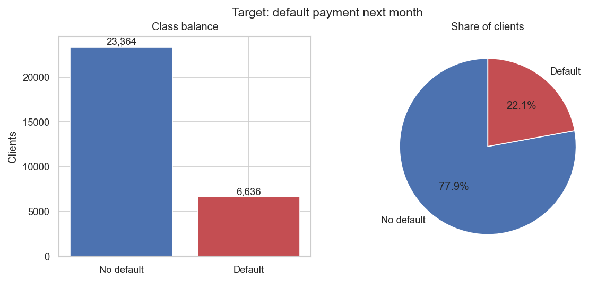

### 3.2 Money amounts are skewed

Every money variable has a long tail to the right, with the mean above the median. The median credit limit is NT$140,000 against a mean of NT$166,967. The EDA therefore reports medians and uses rank-based tests where possible. (These histograms use the capped data. The credit-utilization panel's "median 0" label is a rounding of the true median, 0.31.)

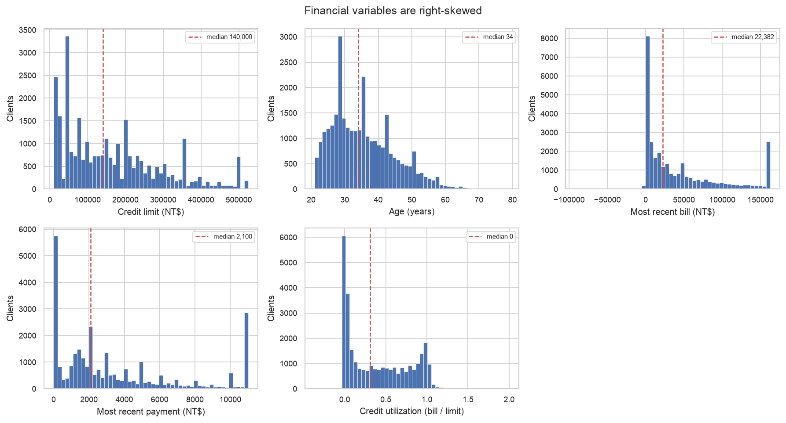

### 3.3 Who the customer is barely matters

Each demographic column was tested against default with a chi-square test. With 30,000 customers almost any difference is "significant", so Cramer's V (an effect size from 0 to 1) is shown too.

| Variable | Default rates | Cramer's V |
|---|---|---|
| `SEX` | Male 24.17%, Female 20.78% | 0.040 |
| `EDUCATION` | Graduate 19.23%, University 23.73%, High school 25.16%, Other 7.05% | 0.073 |
| `MARRIAGE` | Married 23.47%, Single 20.93%, Other 23.61% | 0.031 |

All three are statistically significant (p < .001) and all three are small. Age follows a U shape. The default rate is 26.66% for ages 21 to 25, drops to 19.43% for ages 31 to 35, and rises to 26.84% for ages over 60. A single straight-line measure misses this, so age is better used in bands.

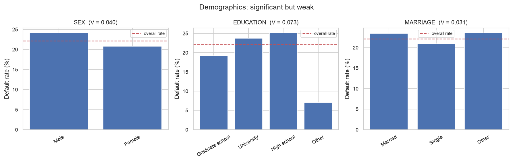

### 3.4 Repayment history is the strongest signal

Customers who were current on their latest payment (paid on time, or no balance) defaulted 13.83% of the time. Customers one or more months late on the latest payment (6,818 customers) defaulted 50.29% of the time, 3.6 times as often. Split further, customers exactly one month late (3,688) defaulted 33.95% of the time, and customers exactly two months late (2,667) defaulted 69.14%. For `PAY_1`, Cramer's V is 0.423, about six times the largest demographic value (0.073).

Counting how many of the six months were late is even cleaner. The default rate rises from 11.71% with no late months to 70.32% with six.

| Late months (of 6) | Customers | Default rate |
|---|---|---|
| 0 | 19,931 | 11.71% |
| 1 | 4,426 | 29.82% |
| 2 | 1,899 | 38.76% |
| 3 | 1,154 | 50.87% |
| 4 | 951 | 57.31% |
| 5 | 298 | 57.38% |
| 6 | 1,341 | 70.32% |

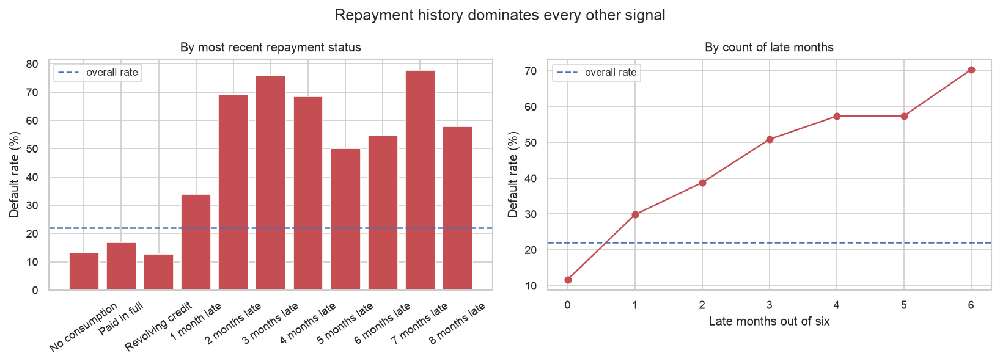

### 3.5 A quirk in the repayment codes

The six status columns look like one measurement repeated six times. They are not recorded the same way. Status 1 (one month late) appears 3,688 times in the most recent month, but only 28, 4, 2, 0 and 0 times in the other five months. Status 2 appears at similar volume every month. The likely explanation is that one-month delays were recorded as 2 in earlier months, but the data does not say.

Two consequences. First, comparing the latest month with an earlier one (for example `PAY_1` minus `PAY_6`) partly measures a recording habit, so we did not build such a trend feature. A naive version labels customers who "improved" as riskier (26.28% default) than customers who stayed flat (16.00%), which is an artifact of the quirk. Second, counting "any late month" is safe, because status 2 and above appear in every month.

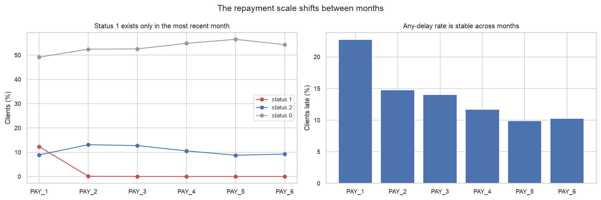

### 3.6 How much was paid, and when trouble happened

Comparing the latest payment (`PAY_AMT1`) with the previous bill (`BILL_AMT2`) gives the share of the bill repaid. Customers with an outstanding bill are grouped below.

| Share of bill repaid | Customers | Default rate |
|---|---|---|
| Nothing | 2,325 | 51.78% |
| Token (under 20%) | 15,803 | 21.12% |
| Partial (20% to 99%) | 3,199 | 15.75% |
| In full | 5,498 | 15.39% |

Paying nothing is the riskiest group in each of the three months tested (51.78%, 49.24% and 45.64%). The order of the other groups is not stable: partial payers default slightly more than full payers in the most recent month and slightly less in the other two. This measure uses amounts, so the status-code quirk does not affect it.

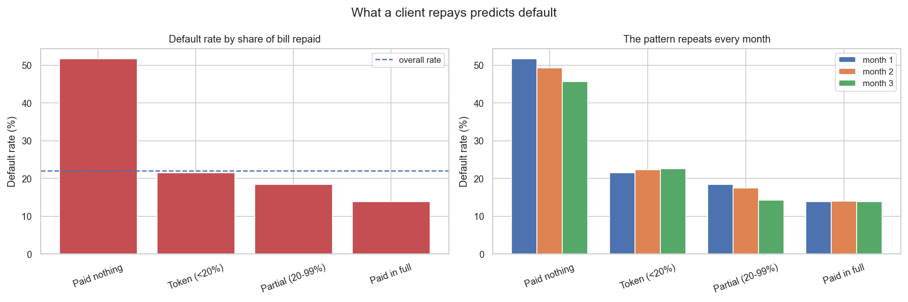

Timing matters too. Customers late only in the two most recent months default at 41.64%. Customers late only in the two oldest months default at 25.97%. Customers late in both windows default at 65.58%, the highest of any group. Recent trouble therefore carries roughly 1.6 times the risk of old trouble. (The right-hand panel's title says lateness is equally common each month. The plotted line actually rises from about 10% in April to about 23% in September, so read the title with care.)

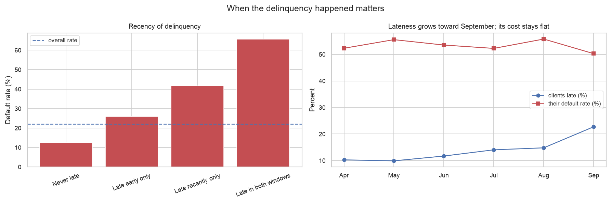

### 3.7 Credit limit, utilization and relationships between columns

- Customers who defaulted had a median credit limit of NT$90,000, against NT$150,000 for those who did not (Cohen's d = -0.38, the clearest gap among the continuous variables). Age shows a negligible gap (d = 0.03).
- Default rises with credit utilization (bill divided by limit), from a low of 14.80% (the fourth-lowest tenth of customers) to 28.73% in the highest tenth.
- The six bill columns are highly correlated with each other (0.79 to 0.95). Variance inflation factors range from 9.0 to 15.5 across them, so a linear model would give unstable weights. Credit limit and age have values near 1.

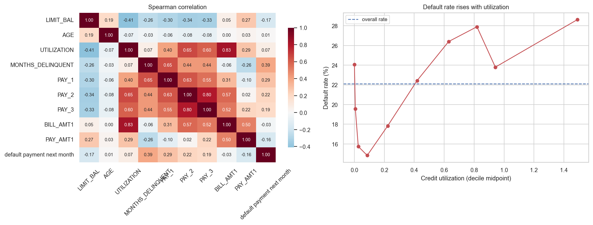

### 3.8 Which single variables separate defaulters best

Each variable was scored alone by AUC (0.5 means no information, 1.0 means perfect). The engineered count of late months scores 0.726, the highest. The repayment columns fill the top of the list and the demographic columns fill the bottom. Age scores 0.504, which is no better than a coin flip in straight-line form.

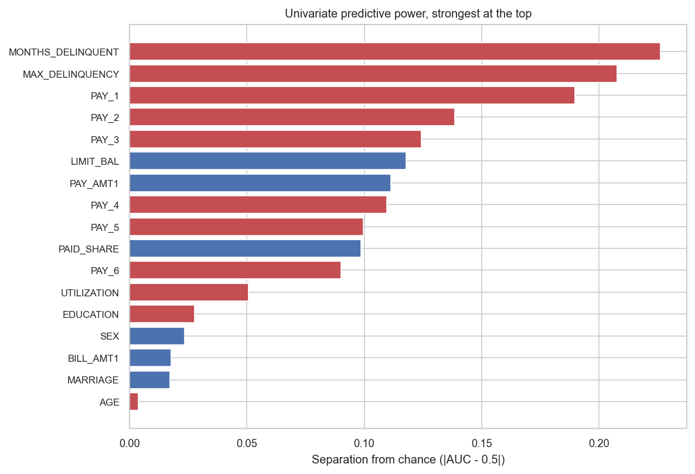

Two other data-quality points are worth stating. About 0.4% of customer-months (618 of 150,000) imply negative spending, likely refunds or adjustments. And 866 customers with zero balance in all six months default at 36.61%, well above the 22.12% average. A zero here marks a different kind of account, not a safe one, so an "inactive account" flag is useful.

### 3.9 Does the cleaning change the answers?

The EDA checked each cleaning step against the raw file. Eight of eleven checks passed, with three judgment concerns: the capping affected over a third of rows, the undocumented repayment codes were treated differently from the undocumented education and marriage codes, and the cap limits were fitted on all rows.

The main results were then recomputed on the raw file. The default rate, the gap between customers one or more months late and current customers (50.29% against 13.83%) and the ranking of variables are the same on both files. The largest difference in any rank correlation with the outcome was 0.0031. So the conclusions describe credit behaviour, not the cleaning.

The raw file also shows what capping hides. 2,115 customers (7.0%) carry a balance above their credit limit, and they default at 30.07% against 21.58% for customers within their limit.

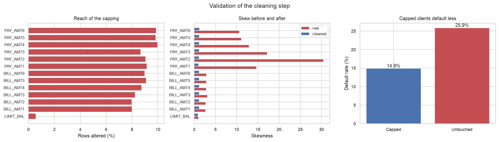

<div class="pagebreak"></div>

## 4. Model Selection

*Sections 4.1 to 4.4, 4.6 and 4.7 are based on the modeling code and findings by Umesh Sharma (`src/modeling.py`). Section 4.5 is the neural network addition by Siddhant Bhura (`src/neural_network.py`).*

**In plain terms.** We tried four kinds of model on three sets of inputs, and compared them fairly on data they had not seen. The two tree-based models came out about equal, and both clearly beat the simplest model. A neural network, added at the team's request, landed in the same narrow band as the trees but did not beat them. We picked one tree model, but the top few are so close that the choice is a judgment call.

### 4.1 Set-up

- **Split.** 80% of customers (24,000) were used to build the model and 20% (6,000) were kept aside as a final exam. The split keeps the default rate the same in both: 22.12% in training and 22.11% in the exam set.
- **Software.** All models come from scikit-learn (Pedregosa et al., 2011).
- **Comparison.** Models were compared with 5-fold cross-validation on the training set only. This means the training data is cut into five parts, and each part takes a turn as the stand-in exam. The exam set was not used to choose a model.
- **Main score.** PR-AUC (area under the precision-recall curve). It rewards finding defaulters without too many false alarms, and it suits a rare outcome (Saito & Rehmsmeier, 2015). A model with no skill scores about 0.221 (the default rate). ROC-AUC, precision, recall and F1 are reported alongside.
- **Imbalance.** The logistic regression and the tree models weight the rare defaulter class more heavily, so they do not ignore it. The neural network has no such setting, and Section 4.5 explains how it was handled instead.
- **Repeatability.** A fixed random seed (42) is used throughout. The numbers in this report come from one run of the code, in the environment listed in Section 8.

### 4.2 Inputs tried

New columns were built from the EDA findings. Each uses only that customer's own row, so none uses the outcome.

| Built column | Meaning |
|---|---|
| `MONTHS_DELINQUENT` | Number of the six months that were late |
| `MAX_DELINQUENCY` | Worst repayment status in the six months |
| `RECENT_LATE`, `DISTANT_LATE` | Number of late months among the latest two, and among the oldest two |
| `PAID_SHARE` | Latest payment divided by the previous bill (set to 0 when the previous bill is zero or negative) |
| `INACTIVE` | 1 if all six bills or all six payments are zero |
| `UTILIZATION` | Latest bill divided by credit limit |
| `AGE_BAND` | Age in bands, because the age effect is U-shaped |

Three input sets of growing size were compared:

| Input set | Contents |
|---|---|
| `baseline_eda` | The EDA's recommended starting point: late-month count, latest status, share repaid, inactive flag, recent and distant lateness, age band |
| `extended` | Baseline plus second-month status, worst status, credit limit, utilization, latest payment |
| `kitchen_sink` | 27 numeric columns: all six statuses, all bills, all payments, plus the built columns |

Sex, education and marital status are left out of every set. They had little predictive value in the EDA, and sex is a protected attribute in consumer lending.

### 4.3 Models tried

| Model | Why it is here | Settings |
|---|---|---|
| Logistic regression | A simple, widely understood benchmark | Balanced class weights, inputs scaled |
| Random forest (Breiman, 2001) | Many decision trees voting | 300 trees, depth up to 12, at least 20 customers per leaf |
| Histogram gradient boosting (Friedman, 2001) | Trees built one after another, each correcting the last | Depth 6, learning rate 0.08, 250 rounds |
| Neural network (MLP; Rumelhart et al., 1986) | Layers of small units that each weigh the inputs and pass a signal on | Searched over a small grid, see Section 4.5 |

### 4.4 Results of the first comparison (logistic regression and trees)

This is the comparison produced by `src/modeling.py`. Section 4.5 adds the neural network to it and gives the combined table.

| Input set | Model | CV PR-AUC (mean) | CV PR-AUC (std) | CV ROC-AUC |
|---|---|---|---|---|
| kitchen_sink | hist_gradient_boosting | 0.5600 | 0.0060 | 0.7811 |
| kitchen_sink | random_forest | 0.5585 | 0.0073 | 0.7844 |
| extended | random_forest | 0.5547 | 0.0082 | 0.7813 |
| extended | hist_gradient_boosting | 0.5542 | 0.0077 | 0.7789 |
| baseline_eda | hist_gradient_boosting | 0.5406 | 0.0089 | 0.7579 |
| baseline_eda | random_forest | 0.5394 | 0.0105 | 0.7579 |
| baseline_eda | logistic_regression | 0.5101 | 0.0121 | 0.7443 |
| kitchen_sink | logistic_regression | 0.5094 | 0.0143 | 0.7638 |
| extended | logistic_regression | 0.5090 | 0.0138 | 0.7615 |

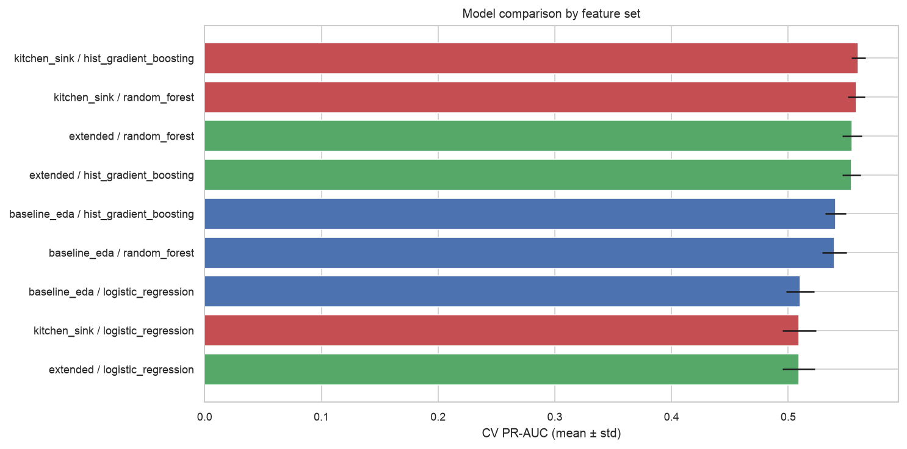

What the table says:

- Both tree models beat logistic regression on every input set. On `baseline_eda` the gap is about 0.03 PR-AUC.
- Adding more inputs helps modestly. The best score rises from 0.5406 (baseline) to 0.5547 (extended) to 0.5600 (kitchen sink).
- The top two rows differ by 0.0015, which is much smaller than the fold-to-fold spread of 0.006 to 0.007. **The two cannot be told apart statistically.** Picking the first row is a judgment call, and a different run environment could reverse the order.
- The bill columns overlap heavily (Section 3.7). Tree models cope with this, which is one reason the linear model gains nothing from the extra columns.

### 4.5 Adding a neural network

*Written by Siddhant Bhura. Code: `src/neural_network.py`. Outputs: `reports/neural_network/`.*

The team asked whether a neural network could be included in Model Selection and Analysis. It can, and it is treated here as a full candidate, scored by the same rules as the other models.

**What it is.** A multilayer perceptron (MLP), trained by back-propagation (Rumelhart et al., 1986). Think of a panel of small voters arranged in layers. Each voter weighs the inputs, passes a signal to the next layer, and the last layer outputs a default probability. It is the standard kind of neural network for a table of numbers. We used scikit-learn's `MLPClassifier`.

**Why this one.** PyTorch, Keras and TensorFlow are not installed in the project environment and are not in `requirements.txt`. For 30,000 rows and about 20 inputs, a small MLP from scikit-learn is the same model family and adds no new software to install.

**Same set-up as the other models.** The script imports the cleaned data, the built columns, the three input sets, the 80/20 split, the 5-fold cross-validation and the scoring code from `src/modeling.py`, which was not changed. The numeric inputs are scaled and `AGE_BAND` is one-hot encoded, the same preprocessing the logistic regression uses.

**Search.** For each input set we tried 24 settings: 3 network sizes (one layer of 32 units, two layers of 64 and 32, two layers of 128 and 64), 4 strengths of weight penalty (0.001, 0.01, 0.1, 1.0) and early stopping on or off. That is 72 networks (plus 3 oversampling trials, one per input set, described below, so 75 in total), each scored by 5-fold cross-validated PR-AUC on the training customers. The other settings are scikit-learn defaults (ReLU units, Adam optimiser), a learning rate of 0.001 and at most 300 passes through the data. When early stopping is on, the network sets aside 10% of its own training rows and stops once that score has not improved for 10 passes. The full grid is in `reports/neural_network/nn_search_results.csv`.

**Imbalance.** A scikit-learn MLP has no class-weight setting, so two other tools were used.

1. The cut-off that turns a probability into a flag was chosen from out-of-fold predictions on the training set only, then applied unchanged to the exam set.
2. For the best setting of each input set we also tried copying defaulters at random until the classes were even. This was done inside each cross-validation fold, on that fold's training rows only. It was kept only if it raised the cross-validated PR-AUC. It never did (for example 0.5440 against 0.5520 on `extended`), so the final networks do not use it.

**Leakage controls.** Leakage means information from the exam set slipping into model building.

- The exam set was used once per final model, after every choice was made.
- Network size, penalty and early stopping were chosen on training-set cross-validation only.
- Copying of defaulters, when tried, never touched validation rows or the exam set.
- The cut-off came from training-set out-of-fold predictions.
- Scaling is part of the pipeline, so it is refitted inside each fold.
- The same carry-over from the cleaning step applies as for the other models (Section 5.4, item 1).

**Fair comparison of the cut-off.** `modeling.py` picks its cut-off from in-sample training scores. For the side-by-side table we re-scored logistic regression, random forest and gradient boosting with the same out-of-fold rule used for the network. Their F1, recall and precision therefore differ slightly from the figures in Section 8.5 (for example F1 0.5402 here against 0.5391 for the selected model). PR-AUC and ROC-AUC do not depend on the cut-off and match the earlier tables.

**Results.** Best network for each input set:

| Input set | Network setting | CV PR-AUC | CV std | Exam PR-AUC | Exam ROC-AUC |
|---|---|---|---|---|---|
| extended | two layers (128, 64), penalty 0.1, early stopping on | 0.5520 | 0.0077 | 0.5527 | 0.7692 |
| baseline_eda | two layers (64, 32), penalty 0.1, early stopping off | 0.5441 | 0.0078 | 0.5379 | 0.7479 |
| kitchen_sink | two layers (64, 32), penalty 1.0, early stopping off | 0.5438 | 0.0099 | 0.5397 | 0.7692 |

Side-by-side with the best version of each other model. "Best" means highest CV PR-AUC across the three input sets. Cut-off columns use the out-of-fold rule described above.

| Model (input set) | CV PR-AUC | CV std | CV ROC-AUC | Exam PR-AUC | Exam ROC-AUC | Exam F1 | Exam recall | Exam precision |
|---|---|---|---|---|---|---|---|---|
| Hist. gradient boosting (`kitchen_sink`) | 0.5600 | 0.0060 | 0.7811 | 0.5499 | 0.7760 | 0.5402 | 0.5546 | 0.5265 |
| Random forest (`kitchen_sink`) | 0.5585 | 0.0073 | 0.7844 | 0.5558 | 0.7750 | 0.5415 | 0.5780 | 0.5093 |
| **Neural network (`extended`)** | **0.5520** | **0.0077** | **0.7787** | **0.5527** | **0.7692** | **0.5419** | **0.5365** | **0.5473** |
| Logistic regression (`baseline_eda`) | 0.5101 | 0.0121 | 0.7443 | 0.5081 | 0.7311 | 0.5224 | 0.5320 | 0.5131 |

The full 12-row table (every model on every input set) is in `reports/neural_network/model_comparison.csv`.

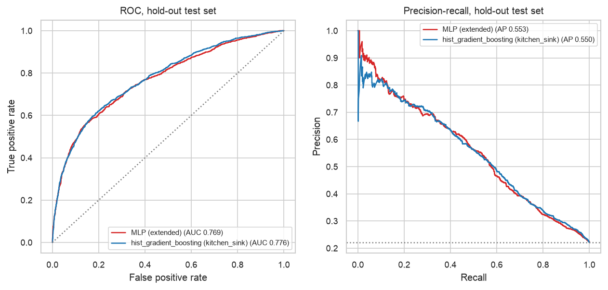

**Verdict.**

- The neural network does **not** beat the trees on cross-validated PR-AUC. It scores 0.5520 against 0.5600 for gradient boosting and 0.5585 for random forest.
- On the exam set its PR-AUC (0.5527) sits between the two tree models (0.5499 and 0.5558). The exam-set gap to the selected model is +0.0028.
- The gaps are about one fold-to-fold spread (0.006 to 0.008), so we call this a tie rather than a win or a loss. We did not run a paired significance test.
- The network clearly beats logistic regression: by about 0.04 PR-AUC on the best input set, and on every input set.
- The curves in Figure 4.2 overlap across most of the range. The network's precision is higher at the very start of the PR curve (the most confident flags), but that part rests on only a few customers.
- The network's exam ROC-AUC (0.7692) is lower than gradient boosting's (0.7760) and random forest's (0.7750).

**Why the network ties the trees rather than beating them.** These are plausible reasons, not proven causes.

- This is a table with about 20 inputs and 30,000 rows, a size where tree ensembles usually match or beat networks.
- Most of the signal is in a few repayment-status columns that take a handful of whole-number values. Trees split on these directly. A network has to build the same steps from smooth functions.
- The outcome is noisy: customers with near-identical histories land on both sides, so every model ends up in a narrow band and there is little room to gain.

**Limits of the network result.**

- Small search: 24 settings per input set, one family of network shapes, one fixed starting seed (42). We did not average over several random starts.
- The cross-validated scores for the winning setting are slightly optimistic, because that setting was picked on the same folds. The exam-set scores are not affected by this.
- Settings with early stopping off ran to the 300-pass limit. The convergence warnings were suppressed in the script, so a longer run might change those scores a little.
- The best penalty (0.1) is inside the grid rather than at its edge, but the other settings were not tuned.
- Not run: PyTorch or Keras, other layer shapes, other activations, other optimisers, other imbalance methods.
- One split and one seed, as for the other models.

### 4.6 Choice

We selected **histogram gradient boosting on the `kitchen_sink` inputs**, because it has the highest cross-validated PR-AUC, including after the neural network was added (Section 4.5). A secondary point is that a boosted tree model is easier to explain to a non-technical reader than a network. The two are too close on accuracy for that to be the deciding reason. Random forest on the same inputs is an equally defensible choice. The neural network is a close third on cross-validation and is not selected, but it is not clearly worse either.

**The repository's saved model output names a different winner.** `reports/model_findings.md` and the model figures in `reports/figures/` come from an earlier run of the same code. That run selected random forest on `kitchen_sink` (CV PR-AUC 0.5583, exam-set PR-AUC 0.5554). This report quotes a fresh run in the pinned environment of Section 8.2, which selected histogram gradient boosting (CV 0.5600, exam-set 0.5499). The difference comes from the scikit-learn version. Re-running the same code with scikit-learn 1.7.2 reproduces the committed file exactly, while version 1.9.1 (pinned in `requirements.txt`) gives the result quoted here. The model figures used here are kept in `reports/report_figures/` so they match the numbers in the text. The team has not yet decided which run to report; this report uses the fresh 1.9.1 run until it does.

### 4.7 Decision threshold

A model outputs a probability, and a cut-off turns it into a yes/no flag. We chose the cut-off that maximised F1 (a balance of precision and recall) on the training set, which gave **0.571**. This is a compromise. A bank would set it from its own costs: what a missed defaulter costs against what an unnecessary contact costs. See Section 5.4 for a caveat on how the cut-off was set.

<div class="pagebreak"></div>

## 5. Model Analysis

*Based on the modeling code and findings by Umesh Sharma. All figures here are scores on the 6,000-customer exam set unless stated.*

**In plain terms.** The model beats guessing by a clear margin and mostly relies on repayment history, as the EDA predicted. It catches a bit over half of the customers who go on to default, and about half of its flags are right. The neural network behaves the same way (Section 5.7). That helps a collections team prioritise. It is not accurate enough to act on a single customer without human review.

### 5.1 Headline results

| Measure | Value |
|---|---|
| PR-AUC | 0.5499 (a no-skill model scores about 0.221) |
| ROC-AUC | 0.7760 |
| Precision (flags that were right) | 52.3% |
| Recall (defaulters found) | 55.6% |
| F1 | 0.5391 |
| Accuracy | 79.0% (always answering "no default" gives 77.9%) |

Accuracy is only 1.1 points above the always-"no" answer, which is why we rely on PR-AUC, precision and recall instead.

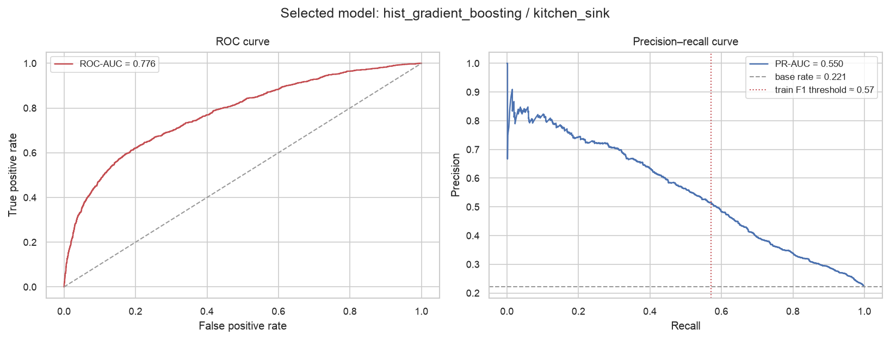

### 5.2 What the model got right and wrong

Of the 6,000 exam customers, 1,327 went on to default.

| | Predicted no default | Predicted default |
|---|---|---|
| **Actually no default** | 4,000 | 673 |
| **Actually default** | 589 | 738 |

- The model found 738 of the 1,327 defaulters (55.6%) and missed 589.
- It flagged 1,411 customers, of whom 738 truly defaulted (52.3%). Flagging 1,411 customers at random would catch about 312.
- It raised 673 false alarms.

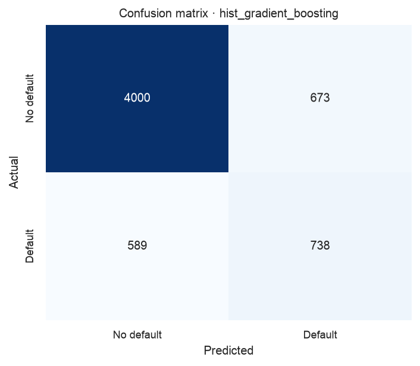

| Class | Precision | Recall | F1 | Customers |
|---|---|---|---|---|
| No default | 0.872 | 0.856 | 0.864 | 4,673 |
| Default | 0.523 | 0.556 | 0.539 | 1,327 |

### 5.3 What drives the predictions

We shuffled each input in turn on the exam set and measured how much the PR-AUC fell. A bigger drop means the model leans on that input more.

| Input | Drop in PR-AUC |
|---|---|
| `PAY_1` (latest repayment status) | 0.0756 |
| `MONTHS_DELINQUENT` | 0.0447 |
| `MAX_DELINQUENCY` | 0.0245 |
| `BILL_AMT1` | 0.0134 |
| `UTILIZATION` | 0.0108 |
| `RECENT_LATE` | 0.0090 |
| `PAY_AMT2` | 0.0071 |

The first three are repayment-history inputs, and they account for most of the model's ability. This agrees with the EDA. Several inputs show a drop of zero or slightly below, meaning they add nothing the others do not already carry. Several of the inputs that drive the model are correlated with each other, so the split of credit among them should not be over-read.

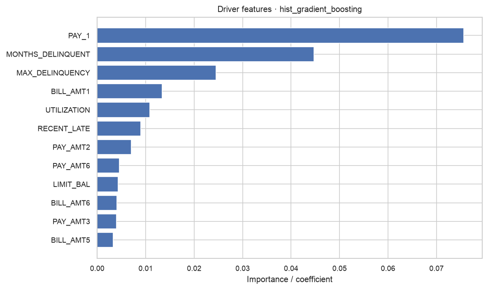

### 5.4 Limitations

1. **Cap limits used all rows.** The cleaning step fixed its cap values from all 30,000 customers before the split, so the exam set had a small influence on preprocessing. The outcome was not used, so we expected the effect to be small. Section 5.5 measured it: PR-AUC fell by 0.003 when the caps were fitted on training rows only. A deployed system should fit the caps on training data only.
2. **The cut-off is not cost-based.** It maximises F1, not money. It was also chosen from the model's scores on the training customers it had already seen. Those scores are more confident than scores on new customers, so the cut-off is somewhat uncertain. Section 5.5 repeats the analysis with the cut-off taken from out-of-fold predictions. The exam-set results above are scored on customers the model did not train on, but they still use this cut-off. Cross-validated recall and precision in Section 4 use the default 0.5 cut-off, so they are not comparable with the exam-set figures.
3. **Top models are tied.** The choice between histogram gradient boosting and random forest rests on a difference smaller than the fold-to-fold spread. The neural network is within about one spread of both (Section 4.5). Other results from this code, including in other environments, differ slightly. The overall picture (tree models around 0.55 PR-AUC, logistic regression around 0.51) is stable.
4. **Raw repayment columns are still included.** The `kitchen_sink` set feeds `PAY_1` to `PAY_6` directly. We avoided differencing them (Section 3.5), but the quirk in the status codes is still present in the inputs. Trees are not very sensitive to it, and we have not tested its effect.
5. **One built column mixes two cases.** `PAID_SHARE` is set to 0 when the previous bill is zero or negative, so "owed nothing" and "paid nothing" look alike.
6. **Old data from one place.** The data is a single Taiwanese issuer in 2005. The results say nothing certain about banks elsewhere or today.
7. **Fairness.** Sex, education and marital status are excluded, but other inputs may act as stand-ins for them. Section 5.6 compares error rates by sex and education on the exam set. It is a first look only, with no confidence intervals and no test for stand-in variables, and it does not cover marital status or age.
8. **Not a causal claim.** The model finds patterns that go with default. It does not show what causes it.

### 5.5 How much do the cap and cut-off choices matter?

Two of the limits above can be measured, so we measured them. The script `src/robustness_checks.py` refits the selected model four ways and scores the same 6,000 exam customers each time. The cap limits are either fitted on all 30,000 rows (as in Section 2) or on the 24,000 training rows only. The cut-off is either taken from training-set scores (as in Section 4.7) or from 5-fold out-of-fold scores.

| Variant | Cut-off | PR-AUC | Caught | Missed | False alarms | Precision | Recall |
|---|---|---|---|---|---|---|---|
| A. As reported: caps on all rows, cut-off from training scores | 0.571 | 0.5499 | 738 | 589 | 673 | 52.3% | 55.6% |
| B. Caps on all rows, cut-off from out-of-fold scores | 0.574 | 0.5499 | 736 | 591 | 662 | 52.6% | 55.5% |
| C. Caps on training rows only, cut-off from training scores | 0.556 | 0.5470 | 760 | 567 | 721 | 51.3% | 57.3% |
| D. Caps on training rows only, cut-off from out-of-fold scores | 0.584 | 0.5470 | 718 | 609 | 640 | 52.9% | 54.1% |

What this shows:

- Fitting the caps on training rows only lowers PR-AUC by 0.003 (0.5499 to 0.5470). That is small next to the fold-to-fold spread of 0.006.
- Changing how the cut-off is chosen leaves PR-AUC unchanged, because PR-AUC does not depend on the cut-off. It moves the cut-off by 0.003 to 0.028 and moves recall by up to about three points and precision by up to about two.
- Across the four variants, recall ranges from 54.1% to 57.3% and precision from 51.3% to 52.9%. So "about 55% found, about 52% of flags right" is a fair summary, and the exact counts (738, 673) are not stable to the last digit.
- This is one split and one random seed. We did not repeat it across seeds.

### 5.6 Error rates by group

The model never sees sex, education or marital status. That does not guarantee equal treatment, because other inputs can carry the same information. The table shows how the selected model behaved for each group on the 6,000 exam customers (variant A). The false-positive rate is the share of customers who did not default but were flagged. The false-negative rate is the share of defaulters who were missed.

| Group | Customers | Actual default rate | Share flagged | False-positive rate | False-negative rate |
|---|---|---|---|---|---|
| Male | 2,402 | 23.4% | 25.5% | 16.2% | 44.0% |
| Female | 3,598 | 21.3% | 22.2% | 13.2% | 44.6% |
| Graduate school | 2,130 | 19.0% | 18.7% | 10.8% | 47.7% |
| University | 2,774 | 23.6% | 26.0% | 16.1% | 41.9% |
| High school | 1,014 | 25.7% | 28.2% | 18.9% | 44.8% |
| Other education | 82 | 6.1% | 6.1% | 5.2% | 80.0% |

- Men and women are missed at nearly the same rate (44.0% and 44.6%). Men who did not default are flagged more often (16.2% against 13.2%), in line with their higher default rate in the data (Section 3.3).
- The false-positive rate rises from 10.8% for graduate-school customers to 18.9% for high-school customers. A customer with only high-school education who would have paid is therefore flagged about 1.7 times as often as one with a graduate degree, although education is not a model input.
- The "Other education" group has 82 customers, so its rates are too noisy to interpret.
- We did not test whether differences of this size could arise by chance, and we did not audit marital status or age.

**Ethics context for credit scoring.** A risk score like this would affect real people, so four points apply to any use beyond this course project. The data are from 2005 and from one country, so the score may not describe today's customers. We do not know what consent the customers gave for this use of their records. If the score were used to cut a limit or refuse credit, lenders in some countries, such as the United States, must give the customer a reason, and a tree ensemble does not give a simple one. A flag should lead to human review or outreach, not an automatic refusal. Finally, a gap in error rates between groups can arise even when a protected attribute is excluded, which is why the group comparison above should be repeated on any new data before use.

### 5.7 The neural network on the exam set

*Written by Siddhant Bhura.*

This section looks at the best neural network (Section 4.5) on the same 6,000 exam customers, at its own cut-off of 0.302. That cut-off came from training-set out-of-fold predictions. It is lower than the tree models' cut-offs, probably because those models weight defaulters more heavily, which shifts their probabilities upward, so the numbers are not comparable across models.

| | Predicted no default | Predicted default |
|---|---|---|
| **Actually no default** | 4,084 | 589 |
| **Actually default** | 615 | 712 |

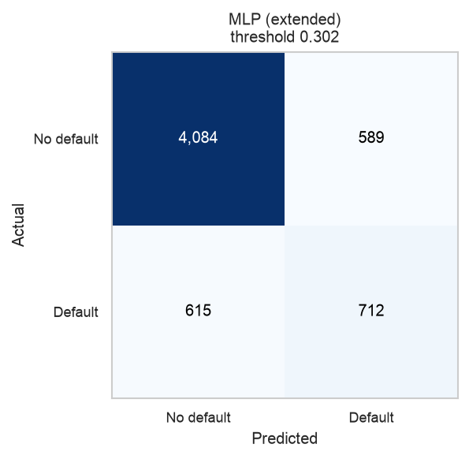

| Measure (exam set) | Neural network | Selected model, same cut-off rule |
|---|---|---|
| PR-AUC | 0.5527 | 0.5499 |
| ROC-AUC | 0.7692 | 0.7760 |
| Recall (defaulters found) | 0.5365 (712 of 1,327) | 0.5546 |
| Precision (flags that were right) | 0.5473 (712 of 1,301 flagged) | 0.5265 |
| F1 | 0.5419 | 0.5402 |

- The network flags fewer customers (1,301) than the selected model does, finds slightly fewer defaulters, and is right slightly more often when it flags. These are differences of about two points and move with the cut-off, as Section 5.5 showed for the selected model.
- For the selected model, the right-hand column uses the cut-off from out-of-fold predictions (variant B of Section 5.5, within one or two customers of the counts shown there).
- Nothing here says the network is more or less accurate than the trees. It ranks customers about equally well.
- The network is harder to explain than the other models. It has no coefficients or split rules to read. We did not compute permutation importance or the group error rates of Section 5.6 for the network, so the claims in those sections apply to the selected tree model only.
- Training is short and repeatable: one fit of the best network took 46 passes with early stopping, and the full script produces identical output files on repeated runs (Section 8.3). The training curves are in Appendix 8.8.
- For a lender that must give a reason for a refusal, the extra opacity is a cost with no accuracy gain in return.

<div class="pagebreak"></div>

## 6. Conclusion and Recommendations

*Compiled from Sections 2 to 5.*

### 6.1 What we found

1. **Late payment is the signal.** Repayment history (how often and how recently a customer paid late) predicts default far better than anything about who the customer is. Customers one or more months late on the latest payment defaulted at 50.29% against 13.83% for those who were current. Customers exactly one month late defaulted at 33.95% and exactly two months late at 69.14%.
2. **The data was clean but had traps.** There were no gaps or repeats. The traps were a two-row header, an inconsistent repayment scale, undocumented category codes, and extreme amounts.
3. **The model ranks customers well above chance.** The selected model reaches a PR-AUC of 0.5499 on unseen customers, against 0.221 for a no-skill model. In this run it found 55.6% of future defaulters, and 52.3% of its flags were right. These two percentages are specific to one run and one cut-off, and moved by a few points in our checks (Section 5.5), so they should not be read as the model's true performance.
4. **Simple models are not enough here, but a neural network adds nothing over trees.** Tree-based models beat logistic regression by about 0.03 to 0.05 PR-AUC. A neural network matched them within noise (exam PR-AUC 0.5527, cross-validated 0.5520 against 0.5600) without beating them, and is harder to explain.
5. **The result has limits.** It has moderate accuracy, an unproven choice between the top two models, and a decision cut-off that is not tied to costs.

### 6.2 Recommendations

1. **Use the model as a ranking tool.** Rank accounts by predicted risk and apply actions by tier, such as early outreach, payment plans, limit review and loss reserves. Do not treat the yes/no flag as a verdict on one customer.
2. **Set the cut-off from costs.** The bank should weigh the cost of a missed defaulter against the cost of an unnecessary contact, and pick the cut-off that minimises expected loss. The F1 cut-off is a placeholder.
3. **Watch repayment behaviour first.** Late counts, recent lateness, and the share of each bill repaid are the most useful early warnings, and they are simple to track.
4. **Keep sex, education and marital status out of decisions** unless a documented fairness review shows they help without unfair impact. Repeat the group error-rate comparison (Section 5.6) on any new data, with confidence intervals, before use.
5. **Fix the preprocessing before any live use.** Fit the capping limits on training data only (Section 5.5 shows the cost was small here), and consider a log transform in place of capping for the tree models.
6. **Tighten the method in follow-up work.** Pick the cut-off from out-of-fold predictions (Section 5.5 shows this changes the counts only slightly), compare the top models, including the neural network, fold by fold with a paired test, record library versions, and re-check performance on recent customers.
7. **Check the repayment-code quirk with the data owner.** Knowing how status 1 and 2 were recorded would settle the main open question about the inputs.

<div class="pagebreak"></div>

## 7. References

Breiman, L. (2001). Random forests. *Machine Learning, 45*(1), 5-32.

Friedman, J. H. (2001). Greedy function approximation: A gradient boosting machine. *The Annals of Statistics, 29*(5), 1189-1232.

Harris, C. R., Millman, K. J., van der Walt, S. J., et al. (2020). Array programming with NumPy. *Nature, 585*, 357-362.

Hunter, J. D. (2007). Matplotlib: A 2D graphics environment. *Computing in Science & Engineering, 9*(3), 90-95.

McKinney, W. (2010). Data structures for statistical computing in Python. *Proceedings of the 9th Python in Science Conference*, 56-61.

Pedregosa, F., Varoquaux, G., Gramfort, A., et al. (2011). Scikit-learn: Machine learning in Python. *Journal of Machine Learning Research, 12*, 2825-2830.

Rumelhart, D. E., Hinton, G. E., & Williams, R. J. (1986). Learning representations by back-propagating errors. *Nature, 323*, 533-536.

Saito, T., & Rehmsmeier, M. (2015). The precision-recall plot is more informative than the ROC plot when evaluating binary classifiers on imbalanced datasets. *PLoS ONE, 10*(3), e0118432.

Seabold, S., & Perktold, J. (2010). Statsmodels: Econometric and statistical modeling with Python. *Proceedings of the 9th Python in Science Conference*, 92-96.

Virtanen, P., Gommers, R., Oliphant, T. E., et al. (2020). SciPy 1.0: Fundamental algorithms for scientific computing in Python. *Nature Methods, 17*, 261-272.

Waskom, M. L. (2021). seaborn: Statistical data visualization. *Journal of Open Source Software, 6*(60), 3021.

Yeh, I.-C. (2009). *Default of Credit Card Clients* [Data set]. UCI Machine Learning Repository. https://doi.org/10.24432/C55S3H

Yeh, I.-C., & Lien, C.-H. (2009). The comparisons of data mining techniques for the predictive accuracy of probability of default of credit card clients. *Expert Systems with Applications, 36*(2), 2473-2480.

<div class="pagebreak"></div>

## 8. Appendix: Code Output and How to Reproduce

### 8.1 Repository contents

| Path | Purpose |
|---|---|
| `src/data_cleaning.py` | Cleans the raw file, runs self-checks, writes the cleaned CSV |
| `src/exploratory_analysis.py` | Produces the EDA tables and figures 01 to 13 |
| `src/modeling.py` | Builds features, compares models, writes the model figures |
| `src/neural_network.py` | Adds a scikit-learn neural network (MLP) to the model comparison. Imports the set-up from `modeling.py`, writes only to `reports/neural_network/` |
| `src/robustness_checks.py` | Read-only checks behind Sections 5.5 and 5.6 (prints only, writes no files) |
| `run_all.py`, `Makefile` | One command that runs every step in order without overwriting tracked files (Section 8.3) |
| `tools/build_report.py` | Builds this PDF from the markdown source (needs `mistune` and `playwright`) |
| `notebooks/final_analysis.ipynb` | Runs the scripts above, shows their output, and includes the neural network section |
| `data/raw/default of credit card clients.xls` | Original UCI file |
| `data/processed/credit_card_default_cleaned.csv` | Cleaned data (30,000 rows, 25 columns) |
| `reports/eda_findings.md`, `reports/model_findings.md` | Full text output of the EDA and modeling steps |
| `reports/figures/` | Figures written by the scripts. The model figures here are from an earlier run (see Section 4.6) |
| `reports/report_figures/` | Model figures from the run quoted in this report, plus the three neural network figures (`nn_01` to `nn_03`) |
| `reports/neural_network/` | Neural network outputs: results text, `model_comparison.csv`, `nn_search_results.csv` and three figures |

### 8.2 Environment used for the numbers in this report

Python 3.14.6, pandas 3.0.6, NumPy 2.5.3, scikit-learn 1.9.1, statsmodels 0.15.0, plus matplotlib, seaborn and SciPy. The neural network uses scikit-learn only. Results for the tree models can shift slightly with different library versions.

### 8.3 How to reproduce

Run from the repository root, in this order.

```
python src/data_cleaning.py
python src/exploratory_analysis.py
python src/modeling.py
python src/robustness_checks.py
python src/neural_network.py
```

- `data_cleaning.py` takes a few seconds and ends with "All self-checks passed".
- `exploratory_analysis.py` takes about 3 seconds.
- `modeling.py` takes about 66 seconds on an idle machine and can take 1 to 4 minutes depending on load.
- `robustness_checks.py` takes about 15 seconds. It prints the tables in Sections 5.5 and 5.6 and writes nothing.
- `neural_network.py` takes about 185 seconds (3 minutes) of wall-clock time on an 18-core Mac, because it cross-validates 72 network settings plus 3 oversampling trials (75 in total), with the 5 folds run in parallel. On a laptop with fewer cores expect longer. It needs the cleaned CSV and imports `modeling.py`. It writes only inside `reports/neural_network/`, and three runs gave byte-identical CSV and image files.

Each script finds its files relative to its own location, so it can be run from any folder. **Running the EDA and modeling scripts overwrites** the files under `reports/` (the findings text and the figures). Copy the folder first if you want to keep the originals, or use the safe `make eda`, `make model` and `make nn` targets, which run in a temporary copy and write to `reproduced/` only. `neural_network.py` overwrites only its own files in `reports/neural_network/`. **One command for everything.** `make all` (or `python run_all.py` on a machine without `make`) runs cleaning, EDA, modeling, the neural network and the robustness checks in order, inside a temporary copy of the repository, then rebuilds this PDF if `mistune` and `playwright` are installed. The fresh outputs are copied to `reproduced/`, and a summary line per folder says how many files are identical to the committed copy. No tracked file is overwritten. In our check, the cleaned CSV, the EDA findings, 13 of 17 saved figures and every neural network file came out byte-identical, while `model_findings.md` and the four `model_*` figures differed (the known run difference in Section 4.6). The whole run took 4.5 minutes on an 18-core Mac when nothing else was running and 7.6 minutes in the last check, so expect 5 to 10 minutes.

### 8.4 Data cleaning output

```
Original shape: (30000, 25)
Final shape:    (30000, 25)
Non-numeric values coerced to missing: none
Missing values before and after cleaning: 0 in every column
Full-row duplicates found: 0     ID duplicates found: 0

Outlier capping (IQR method):
  LIMIT_BAL: 167    BILL_AMT1: 2400   BILL_AMT2: 2395   BILL_AMT3: 2469
  BILL_AMT4: 2622   BILL_AMT5: 2725   BILL_AMT6: 2693   PAY_AMT1: 2745
  PAY_AMT2: 2714    PAY_AMT3: 2598    PAY_AMT4: 2994    PAY_AMT5: 2945
  PAY_AMT6: 2958
  Total values capped: 32425

EDUCATION before: 0:14  1:10585  2:14030  3:4917  4:123  5:280  6:51
EDUCATION after:  1:10585  2:14030  3:4917  4:468   (345 recoded)
MARRIAGE before:  0:54  1:13659  2:15964  3:323
MARRIAGE after:   1:13659  2:15964  3:377   (54 recoded)

All self-checks passed.
```

### 8.5 Modeling output

Hold-out test results by model (threshold tuned for F1 on the training set):

```
 feature_set                  model  threshold  test_pr_auc  test_roc_auc  test_precision  test_recall  test_f1
kitchen_sink hist_gradient_boosting      0.571       0.5499        0.7760          0.5230       0.5561   0.5391
kitchen_sink          random_forest      0.437       0.5558        0.7750          0.4423       0.6436   0.5242
    extended          random_forest      0.481       0.5548        0.7718          0.4552       0.6089   0.5210
    extended hist_gradient_boosting      0.511       0.5538        0.7712          0.4765       0.5885   0.5266
baseline_eda hist_gradient_boosting      0.542       0.5354        0.7537          0.5058       0.5584   0.5308
baseline_eda          random_forest      0.519       0.5415        0.7531          0.4901       0.5787   0.5308
baseline_eda    logistic_regression      0.565       0.5081        0.7311          0.5196       0.5283   0.5239
kitchen_sink    logistic_regression      0.542       0.4994        0.7489          0.4766       0.5592   0.5146
    extended    logistic_regression      0.565       0.4980        0.7447          0.4876       0.5479   0.5160
```

Note that on exam-set PR-AUC alone, random forest on `kitchen_sink` (0.5558) is slightly above the selected model (0.5499). Selection used cross-validation on the training set only, as described in Section 4.1, and these two differ by less than the spread between folds or between runs.

Classification report and confusion matrix for the selected model:

```
              precision    recall  f1-score   support

  No default      0.872     0.856     0.864      4673
     Default      0.523     0.556     0.539      1327

    accuracy                          0.790      6000
   macro avg      0.697     0.706     0.701      6000
weighted avg      0.795     0.790     0.792      6000

                 Pred No-default   Pred Default
Actual No-default          4000             673
Actual Default              589             738
```

Permutation importance (drop in exam-set PR-AUC), top 10:

```
PAY_1                0.0756      BILL_AMT1            0.0134
MONTHS_DELINQUENT    0.0447      UTILIZATION          0.0108
MAX_DELINQUENCY      0.0245      RECENT_LATE          0.0090
PAY_AMT2             0.0071      PAY_AMT6             0.0046
LIMIT_BAL            0.0043      BILL_AMT6            0.0040
```

### 8.6 Robustness and group-error output

```
== Threshold and cap-limit checks (hold-out set, 6,000 rows) ==
A. As in the report: caps on all rows, threshold from train preds
  threshold=0.571  PR-AUC=0.5499  ROC-AUC=0.7760
  caught=738  missed=589  false_alarms=673  precision=0.523  recall=0.556  accuracy=0.790
B. Caps on all rows, threshold from out-of-fold predictions
  threshold=0.574  PR-AUC=0.5499  ROC-AUC=0.7760
  caught=736  missed=591  false_alarms=662  precision=0.526  recall=0.555  accuracy=0.791
C. Caps on training rows only, threshold from train preds
  threshold=0.556  PR-AUC=0.5470  ROC-AUC=0.7745
  caught=760  missed=567  false_alarms=721  precision=0.513  recall=0.573  accuracy=0.785
D. Caps on training rows only, threshold from out-of-fold
  threshold=0.584  PR-AUC=0.5470  ROC-AUC=0.7745
  caught=718  missed=609  false_alarms=640  precision=0.529  recall=0.541  accuracy=0.792

== Error rates by group, variant A (hold-out set) ==
FPR = share of non-defaulters flagged; FNR = share of defaulters missed.
Group                         n  default  flagged    FPR    FNR  precision  recall
SEX / Male                 2402    0.234    0.255  0.162  0.440      0.512   0.560
SEX / Female               3598    0.213    0.222  0.132  0.446      0.531   0.554
EDUCATION / Graduate       2130    0.190    0.187  0.108  0.477      0.533   0.523
EDUCATION / University     2774    0.236    0.260  0.161  0.419      0.528   0.581
EDUCATION / High school    1014    0.257    0.282  0.189  0.448      0.503   0.552
EDUCATION / Other            82    0.061    0.061  0.052  0.800      0.200   0.200
```

### 8.7 Further EDA figures

The remaining figures from the EDA script are in `reports/figures/`: `08_group_comparisons.png`, `11_data_quality.png` and `13_raw_comparison.png`.

### 8.8 Neural network output

Best network per input set and the best of each other model (cut-off from out-of-fold predictions on the training set; source `reports/neural_network/model_comparison.csv`):

```
feature_set   model                   cv_pr_auc  cv_std  test_pr_auc  test_roc_auc  test_f1  test_recall  test_precision
extended      mlp_neural_network      0.5520     0.0077  0.5527       0.7692        0.5419   0.5365       0.5473
baseline_eda  mlp_neural_network      0.5441     0.0078  0.5379       0.7479        0.5308   0.5772       0.4913
kitchen_sink  mlp_neural_network      0.5438     0.0099  0.5397       0.7692        0.5307   0.5237       0.5379
kitchen_sink  hist_gradient_boosting  0.5600     0.0060  0.5499       0.7760        0.5402   0.5546       0.5265
kitchen_sink  random_forest           0.5585     0.0073  0.5558       0.7750        0.5415   0.5780       0.5093
baseline_eda  logistic_regression     0.5101     0.0121  0.5081       0.7311        0.5224   0.5320       0.5131
```

Chosen network: `extended` inputs, hidden layers (128, 64), penalty 0.1, early stopping on, cut-off 0.3024. Confusion matrix on the exam set: 4,084 true negatives, 589 false positives, 615 false negatives, 712 true positives.

Training curves for the chosen network (46 passes run; the dashed line marks the best internal validation score, after which training continued until the 10-pass patience ran out):

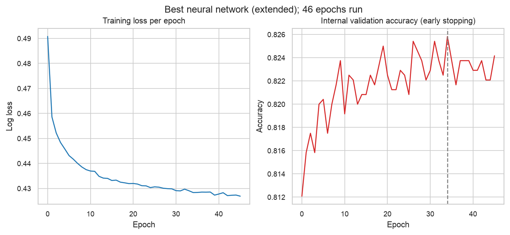

### 8.9 Executed notebook (code and output)

The course asks for the output of the code from a Jupyter notebook. The PDF version of this report ends with the executed notebook `notebooks/final_analysis.ipynb`: each code cell followed by what it printed. Its numbers come from running the scripts above. Pictures are left out of this PDF copy (each is marked in the text below). They are in the notebook file, and most are the same figures shown in Sections 3 to 5. If the PDF is rebuilt on a machine without `nbconvert`, this part is skipped and the notebook file itself is the appendix.

